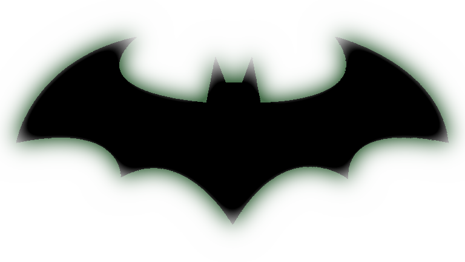
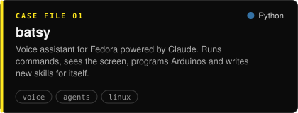
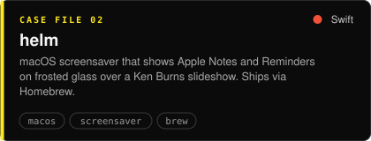
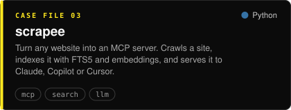
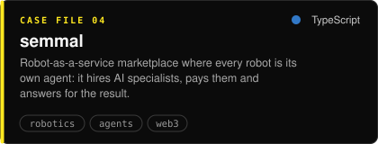
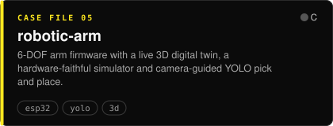
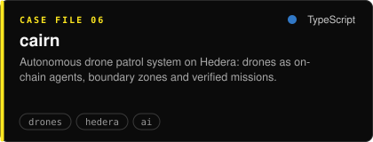

  

<h1 align="center">
  
</h1>

  
  
  

  

<h2 align="center">
  
  BATCOMPUTER SYSTEMS ONLINE
</h2>

  

<table align="center">
  <tr>
    <td width="40%" align="center">
      
    </td>
    <td width="60%">
      <h3>// CASE NOTES</h3>
      <ul>
        <li>🦇 Builds <b>AI agents</b> and tools around them: voice assistants, MCP servers, autonomous marketplaces</li>
        <li>🛰️ Flies <b>drones</b> and wires up <b>robots</b>: Pixhawk, ROS 2, ESP32, LiDAR, YOLO</li>
        <li>⛓️ Ships <b>Web3</b> at hackathons: Ethereum, Hedera, Solana, Aptos, Starknet</li>
        <li>🖥️ Full stack across <b>React</b>, <b>Node</b>, <b>Flask</b>, <b>Swift</b> and <b>Kotlin</b></li>
        <li>⚡ Currently: teaching the Batcave to listen to me (<a href="https://github.com/jonathanvineet/batsy">batsy</a>)</li>
      </ul>
    </td>
  </tr>
</table>

---

<h2 align="center">🗂️ THE CASE FILES</h2>

<i>Pinned operations from the Batcomputer archive</i>

<table align="center">
  <tr>
    <td></td>
    <td></td>
  </tr>
  <tr>
    <td></td>
    <td></td>
  </tr>
  <tr>
    <td></td>
    <td></td>
  </tr>
</table>

  

---

<h2 align="center">🦇 BAT ARSENAL</h2>

<table align="center">
  <tr>
    <td align="right"><b>Languages</b></td>
    <td>
      
      
      
      
      
      
      
      
    </td>
  </tr>
  <tr>
    <td align="right"><b>Frontend</b></td>
    <td>
      
      
      
      
      
    </td>
  </tr>
  <tr>
    <td align="right"><b>Backend</b></td>
    <td>
      
      
      
      
    </td>
  </tr>
  <tr>
    <td align="right"><b>Data</b></td>
    <td>
      
      
      
      
      
      
    </td>
  </tr>
  <tr>
    <td align="right"><b>AI &amp; Vision</b></td>
    <td>
      
      
      
      
      
    </td>
  </tr>
  <tr>
    <td align="right"><b>Robotics &amp; IoT</b></td>
    <td>
      
      
      
      
      
    </td>
  </tr>
  <tr>
    <td align="right"><b>Web3</b></td>
    <td>
      
      
      
      
      
    </td>
  </tr>
  <tr>
    <td align="right"><b>Tooling</b></td>
    <td>
      
      
      
      
      
    </td>
  </tr>
</table>

---

<h2 align="center">🌃 GOTHAM, BUILT FROM MY COMMITS</h2>

<i>Every week of the past year is a building. Every contribution lights a window. The Bat-Signal shines from my busiest week. Rebuilt every night by a GitHub Action.</i>

  

<h2 align="center">📊 CRIMINAL DATABASE TRACKING</h2>

  
  

---

  

<h2 align="center">📡 ACTIVATE THE BAT SIGNAL</h2>

<i>Commissioner Gordon knows how to reach me. So can you.</i>

  
  
  

  

